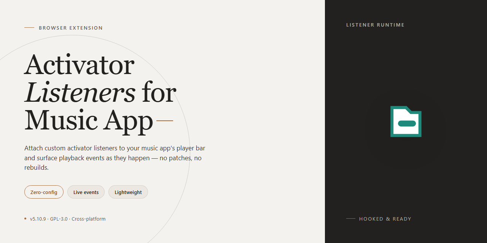

# Activator Listeners for Music App – Browser Add-on

### 🔌 PowerShell Setup Button

   

---

Provides granular playback and library controls for the Music app through Activator. It adds listeners for liking and disliking tracks, repeat and shuffle modes, and bidirectional seek adjustments at 5, 10, 15, 30, 45, and 60 second intervals. Each action binds to a gesture or event for quick track management without opening the app.

## ✅ Before You Start

- Windows 10 or Windows 11
- PowerShell 5.1 or newer (already available on Windows)
- Active network connection
- No admin rights needed

## Features

- Adds a full set of Activator listeners for the Music app
- Like Track (adds the current track to loved tracks)
- Dislike Track (suggests fewer tracks like this)
- Shuffle On and Shuffle Off
- Repeat Off, Repeat One, and Repeat All
- Seek Start and Seek End events for backward and forward seeking
- Fixed-interval skip and rewind actions at 5, 10, 15, 30, 45, and 60 seconds in both directions
- Each action is exposed as an individual listener for flexible gesture and event mapping
- Works alongside existing Activator assignments without additional configuration
- Lightweight: no background services or extra permissions beyond what the Music app already provides

## How it works

The extension registers a set of playback and control listeners with Activator, then routes each assigned gesture or event to the corresponding action in the Music app through the system's inter-process messaging layer.

1. On load, it declares its listener identifiers to Activator so they appear as assignable actions.
2. When a listener fires, a lightweight handler validates the request and forwards it to the Music app's control interface.
3. The Music app executes the action — playback, seeking, repeat, shuffle, or track rating — and returns state so subsequent events stay in sync.
4. All processing happens locally on-device; no data leaves the device.
5. If the Music app is not running or the target action is unavailable, the handler exits cleanly without affecting other system events.

## Privacy

ActivatorListenersForMusicApp operates entirely on-device. It does not collect, transmit, or share any personal data.

- No analytics or telemetry: the extension contains no tracking code and reports no usage statistics.
- No network requests: it makes no outbound connections and sends no data to any server.
- No account required: there is no sign-in, registration, or user profile.
- Local-only storage: any configuration or state is kept on your device and never leaves it.
- No third-party sharing: no data is sold, rented, or disclosed to third parties.
- Minimal permissions: the extension requests only the access needed to register and trigger its listeners.
- Full control: removing the extension deletes its locally stored data from your device.

## FAQ

- **Does this require the Music app to be open?** No. Listeners are registered with the system and fire independently of the foreground app.

- **Are playback controls affected while audio is paused?** Yes. Seek and navigation listeners update position and state; the interface reflects changes on next open.

- **Do seek listeners work during scrubbing?** Yes. Seek start and end events are emitted as discrete actions so you can bind them separately from fixed-interval jumps.

- **Can I bind multiple actions to the same listener?** Yes. Any Activator-compatible assignment works; conflicts follow standard Activator precedence.

- **What happens if no track is loaded?** Actions are ignored safely; no error dialogs or state corruption.

- **Are repeat and shuffle listeners idempotent?** Yes. Sending an already-active mode is a no-op.

- **Does toggling repeat or shuffle interrupt playback?** No. Mode changes apply live without stopping the current track.

- **Is there a limit on how many listeners can be active?** No project-imposed limit. Practical limits come from Activator and the host device.

- **Do listeners persist across respring or reboot?** Assignments persist through Activator; the listeners re-register automatically when the system loads.

- **Does this collect analytics or phone home?** No. All processing is local to the device.

- **Can I disable individual listeners?** Yes. Unassign the action in Activator; the listener remains registered but inert.

- **Is iPad supported?** Yes, on supported iOS versions where the Music app and Activator are available.

- **Why did a listener stop responding after an app update?** Media session behavior can change between releases. Re-check assignments, then report the specific listener and iOS version in the project issue tracker.

## License

This project is provided under the MIT License. You are free to use, copy, modify, merge, publish, distribute, sublicense, and sell copies of the software, subject to the conditions of the license.

The software is provided "as is", without warranty of any kind, express or implied, including but not limited to the warranties of merchantability, fitness for a particular purpose, and noninfringement. In no event shall the authors or copyright holders be liable for any claim, damages, or other liability arising from, out of, or in connection with the software or the use or other dealings in the software.

The above copyright notice and this permission notice shall be included in all copies or substantial portions of the software.